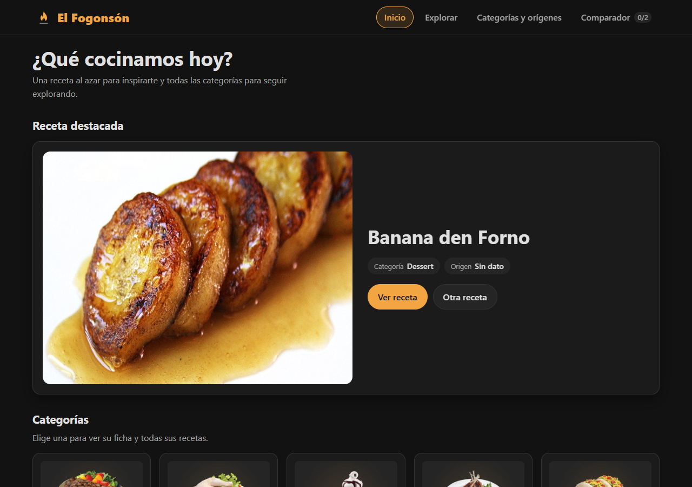
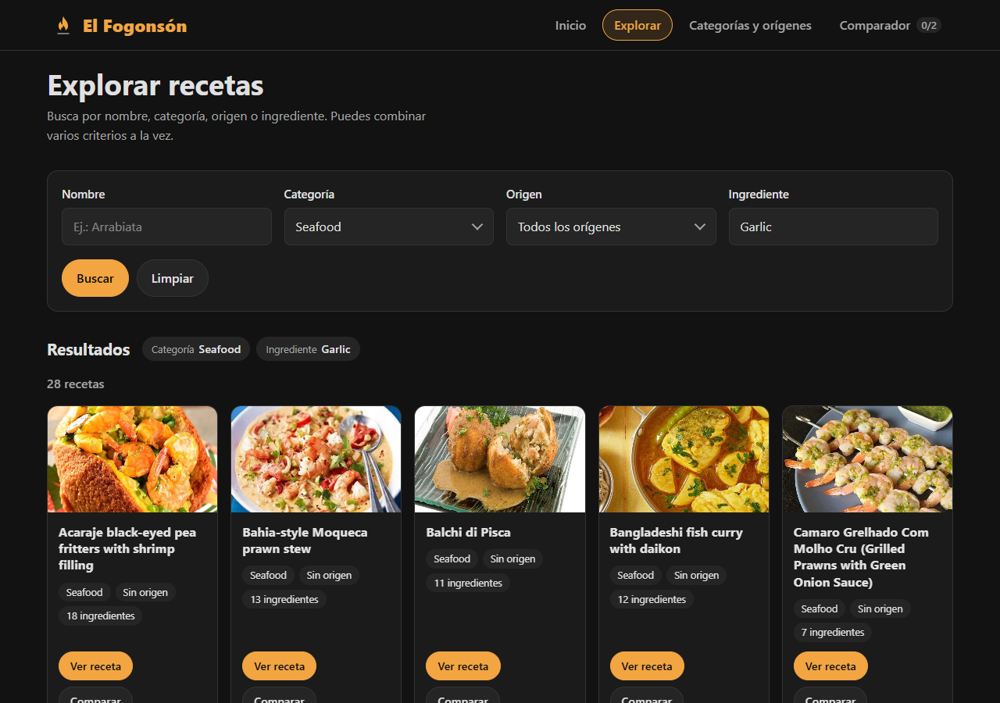
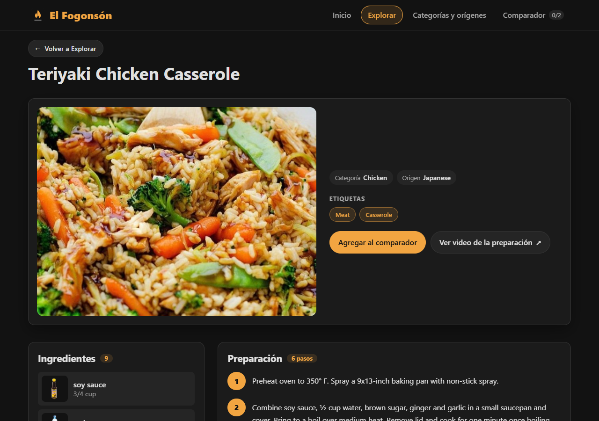
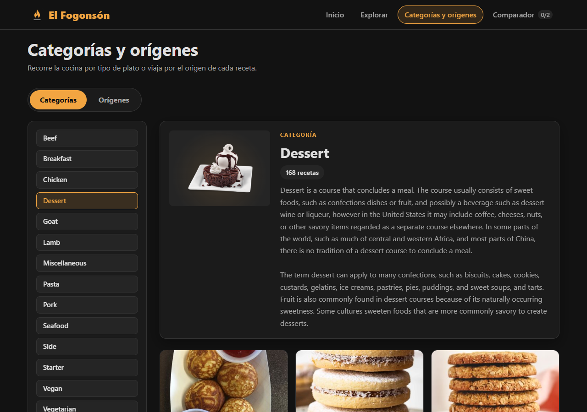
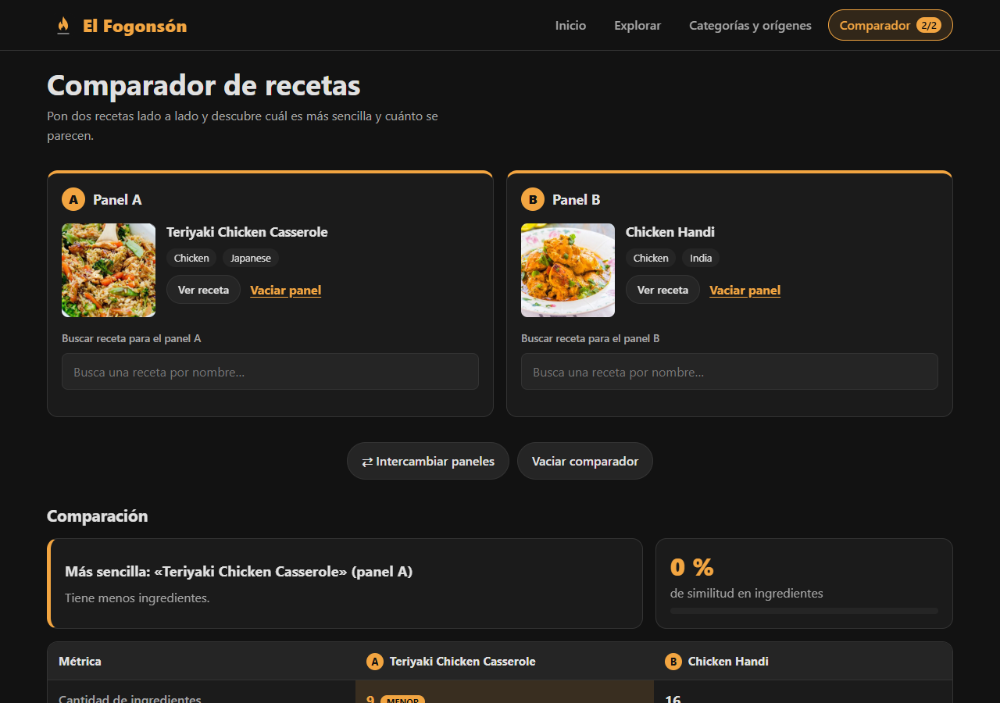
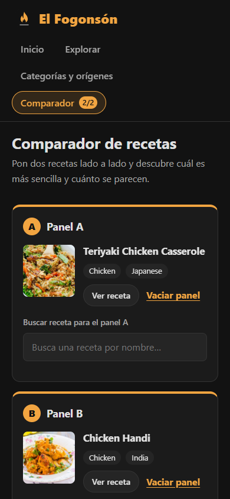
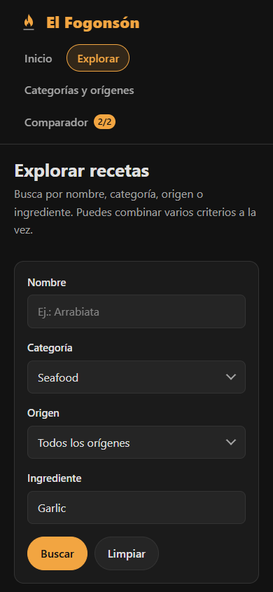

# El Fogonsón

**El Fogonsón** es una aplicación web de página única (SPA) para explorar, consultar y comparar recetas de cocina de todo el mundo. Todos los datos se piden en tiempo de ejecución a la API pública [TheMealDB](https://www.themealdb.com/api.php): no hay datos locales ni persistencia.

Proyecto 2 de Desarrollo de Lenguajes para Clientes Web (URU), con HTML5, CSS3 y JavaScript sin librerías.

## Vistas

| Vista | Qué hace |
| --- | --- |
| Inicio | Receta destacada al azar (sin repetirse de forma consecutiva) y cuadrícula con todas las categorías. |
| Explorar | Busca por nombre, categoría, origen e ingrediente (con sugerencias). Los criterios se combinan por intersección; resultados ordenados y paginados de 12 en 12. |
| Detalle | Imagen, categoría, origen, etiquetas, ingredientes con imagen, pasos numerados, video y hasta 6 recetas relacionadas por categoría y 6 por origen. El botón Volver conserva la búsqueda, los filtros y la página. |
| Categorías y orígenes | Dos pestañas con la ficha de cada categoría u origen y sus recetas, con la misma paginación de Explorar. |
| Comparador | Dos paneles con buscador propio, intercambio y vaciado, y la comparación de métricas con la receta más sencilla. |

## Integrantes

| Integrante | División del trabajo |
| --- | --- |
| Leandro Jay (`Lejayk`) | Servicios (petición centralizada, caché, normalización, sesión y métricas del comparador), pseudocomponente base y navegación, vistas de inicio, explorar, detalle, categorías y orígenes, panel y tabla del comparador. |
| Santiago (`santrix329`) | Núcleo inicial de la SPA (`index.html`, estilos base, `app.js`), primeras versiones del servicio de la API y de la caché, y primera versión de la vista del comparador (estado vacío, intercambio y vaciado). |

## Cómo ejecutarlo

Abrir `index.html` en el navegador. No necesita servidor ni instalación; hace falta conexión a internet porque los datos se piden a TheMealDB.

## Estructura

```
index.html                        barra de navegación + contenedor de vistas
css/styles.css                    base: tokens en :root, botones, tarjetas, estados, tabla de comparación
css/explorar.css, detalle.css, categorias.css, comparador.css   estilos de cada vista
assets/icono.svg                  ícono de la aplicación
assets/ingrediente-alternativo.svg  imagen alternativa de ingredientes
js/servicios/recetas.js           normalización, intersección y orden de recetas
js/servicios/cache.js             caché en memoria (sin persistencia)
js/servicios/api.js               petición centralizada y endpoints permitidos
js/servicios/sesionComparador.js  las dos recetas del comparador
js/servicios/comparacion.js       métricas del comparador y receta más sencilla
js/utilidades/dom.js              crearNodo: construye nodos sin innerHTML
js/componentes/                   pseudocomponentes (uno por archivo)
js/vistas/                        vistas, también pseudocomponentes
js/app.js                         punto de entrada, cambio de vistas y acciones entre vistas
```

## Pseudocomponentes

Todos heredan de `Componente`, que separa `crearElemento`, `renderizar`, `configurarEventos` y `destruir`. Cada uno recibe en su constructor el contenedor donde se monta y sus propiedades, guarda su estado y lo cambia solo con sus propios métodos. Se comunican con `CustomEvent` (los datos viajan en `detail`) y ninguno toca el DOM interno de otro. Al cambiar de vista, la vista anterior se destruye junto con todos sus pseudocomponentes, sus eventos, temporizadores y peticiones en curso.

| Pseudocomponente | Responsabilidad | Eventos que emite |
| --- | --- | --- |
| `BarraNavegacion` | Acceso a las vistas, vista activa y contador del comparador (0, 1 o 2). | `navegacion:ir` `{ vista }` |
| `EstadoCarga` | Indicadores de carga con la forma del contenido, estado vacío y error con reintento. | `estado:reintentar` `{ seccion }` |
| `Aviso` | Mensaje breve en pantalla (reemplaza a `alert`). | `aviso:cerrar` |
| `DialogoReemplazo` | Pregunta qué panel del comparador reemplazar (reemplaza a `confirm`). | `reemplazo:elegir` `{ indice }`, `reemplazo:cancelar` |
| `RecetaDestacada` | Receta al azar de la vista de inicio. | `receta:abrir` `{ id }`, `destacada:otra` `{ id }` |
| `TarjetaCategoria` | Categoría con imagen, nombre y descripción recortada a 120 caracteres. Se instancia una vez por categoría. | `categoria:abrir` `{ nombre }` |
| `TarjetaReceta` | Receta con imagen, nombre, categoría, origen y cantidad de ingredientes; se marca incompleta si falla su detalle. Se reutiliza en explorar, categorías y orígenes y relacionadas. | `receta:abrir` `{ id }`, `receta:comparar` `{ id }`, `tarjeta:reintentar` `{ id }` |
| `Paginador` | Anterior, siguiente y "Página x de y". | `paginador:cambiar` `{ pagina }` |
| `ListadoRecetas` | Cuadrícula paginada que resuelve en paralelo el detalle de la página visible. | `listado:pagina` `{ pagina }` |
| `FormularioBusqueda` | Criterios de explorar con validación junto a cada campo. | `busqueda:enviar` `{ criterios }`, `busqueda:limpiar` |
| `CampoSugerencias` | Campo de ingrediente con sugerencias filtradas mientras se escribe (combobox accesible). | `sugerencias:cambiar` `{ valor }`, `sugerencias:elegir` `{ valor }` |
| `CabeceraReceta` | Imagen, categoría, origen, etiquetas, video y botón para comparar. | `receta:comparar` `{ id }` |
| `ListaIngredientes` | Ingredientes con imagen (con alternativa si no carga), nombre y medida. | — |
| `PasosPreparacion` | Pasos numerados. | — |
| `Pestanas` | Pestañas accesibles (flechas, Inicio, Fin). | `pestanas:cambiar` `{ id }` |
| `ListaOpciones` | Lista de categorías u orígenes, con filtro opcional. Se instancia una vez por pestaña. | `opcion:elegir` `{ valor }` |
| `EncabezadoFicha` | Encabezado de la ficha de una categoría o de un origen. | — |
| `PanelComparador` | Panel A o B: su receta y un buscador por nombre que espera 400 ms (debounce) y cancela la búsqueda anterior con `AbortController`. Se instancia dos veces. | `panel:elegir` `{ indice, receta }`, `panel:vaciar` `{ indice }`, `receta:abrir` `{ id }` |
| `TablaComparacion` | Métricas entre A y B: resalta el menor valor numérico, etiquetas e ingredientes en común y exclusivos, similitud y receta más sencilla. | — |
| `VistaInicio`, `VistaExplorar`, `VistaDetalle`, `VistaCategoriasOrigenes`, `VistaComparador` | Componen los pseudocomponentes de cada vista. `VistaDetalle` emite `vista:volver`. | — |

## `Promise.all` y `Promise.allSettled`

| Dónde | Cuál | Por qué |
| --- | --- | --- |
| `VistaInicio.cargarInicio` | `Promise.allSettled` | La receta destacada y las categorías son independientes: si una falla, la otra se muestra igual y la que falló ofrece reintentar. |
| `ListadoRecetas.mostrarPagina` | `Promise.allSettled` | El detalle de cada receta de la página es independiente: si una falla, solo esa tarjeta queda incompleta y ofrece reintentar. |
| `VistaDetalle.cargarRelacionadas` | `Promise.allSettled` | Las relacionadas por categoría y por origen son dos secciones separadas: el fallo de una no impide mostrar la otra. |
| `VistaExplorar` (carga del formulario) | `Promise.all` | El formulario necesita las tres listas (categorías, orígenes, ingredientes) para ofrecer todos sus criterios. |
| `VistaExplorar.buscar` | `Promise.all` | La intersección necesita la lista de cada criterio aplicado: si falta una, no hay resultado correcto que mostrar. |
| `VistaCategoriasOrigenes` (ficha de categoría) | `Promise.all` | La ficha necesita a la vez los datos de la categoría y sus recetas. |

## Comparador: cómo se calcula

- **Cantidad de ingredientes, de pasos y de palabras de las instrucciones**: se resalta el menor valor.
- **Categoría y origen**: el valor de cada receta y si coinciden.
- **Etiquetas e ingredientes en común, ingredientes exclusivos de A y de B**: sin distinguir mayúsculas y sin espacios sobrantes.
- **Similitud**: ingredientes en común dividido entre el total de ingredientes distintos de ambas, como porcentaje entero.
- **Receta más sencilla**: la de menos ingredientes; si empatan, la de menos pasos; si siguen empatadas, la de menos palabras; si no, empate.

## Decisiones de diseño

- **Nombre e idea**: *El Fogonsón* juega con el fogón, el fuego donde se cocina. La interfaz se piensa como una cocina de noche iluminada por la brasa: fondo oscuro y un único color cálido que marca todo lo importante.
- **Paleta**:
  - Fondo `#121212`, superficies `#1b1b1b` y `#252525`, bordes `#333333`.
  - Texto `#e0e0e0` y texto secundario `#a6a6a6`.
  - Acento ámbar `#f2a541`, el color de la brasa: vista activa, botones principales, valores menores del comparador, foco del teclado.
  - Error `#ff7a6b`, reservado para fallos y avisos.
- **Tipografía**: la familia del sistema (`Segoe UI`, Tahoma, Verdana, sans-serif). No depende de fuentes externas, carga al instante y se lee bien en pantalla. Títulos en 700–800 y texto en 400–600.
- **Iconografía**: un único ícono propio, la llama (`assets/icono.svg`), con la misma paleta, para la marca y la pestaña del navegador. Las acciones usan símbolos de texto (←, ⇄, ×) siempre acompañados de una etiqueta o de un `aria-label`; nunca un ícono solo. La imagen alternativa de ingredientes sigue el mismo trazo.
- **Estados diseñados**: cada sección tiene carga con la forma del contenido, vacío, error con reintento y elemento activo. Todo lo interactivo tiene *hover* y foco visible, y la navegación por teclado funciona en pestañas, sugerencias y diálogo.
- **Referencias de inspiración**: la luz cálida de una cocina de leña y las cartas de restaurante con fondo oscuro, donde la comida es lo único iluminado.

## Capturas

| Inicio | Explorar |
| --- | --- |
|  |  |

| Detalle | Categorías y orígenes |
| --- | --- |
|  |  |

| Comparador | En celular |
| --- | --- |
|  |   |
